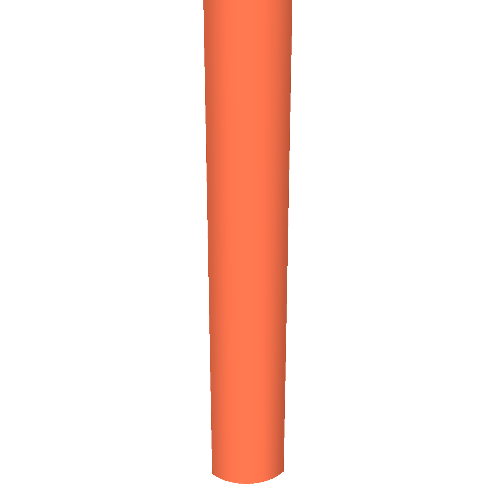

# AeroMet V1 — Solid-State Roof Weather & Air-Quality Station

Open-source roof weather and air-quality station (`Ø 96 × 207 mm` in UV-stabilized ASA) with no moving parts. It measures wind speed and direction by ultrasonic time-of-flight, rainfall and hail by acoustic impact on a 4-piezo dome, UV and solar radiation under a fused-silica quartz hemisphere, temperature, humidity, barometric pressure, lightning distance, and outdoor air quality ($\text{PM}_{1.0}$, $\text{PM}_{2.5}$, $\text{PM}_{4.0}$, $\text{PM}_{10}$, $\text{VOC}$, $\text{NO}_x$, and $\text{CO}_2$).

The station runs from a wired `12–32 V DC` supply and communicates over both **Wi-Fi** (boosted by an internal `2.4 / 5.8 GHz` U.FL dipole antenna) and **RS-485** (`115,200 bps` over the spare pair in a 4-wire roof cable).

| Isometric (`iso.png`) | Cutaway Section (`section.png`) | X-Ray Inside (`inside.png`) | Exploded View (`exploded.png`) |
| :---: | :---: | :---: | :---: |
|  |  |  |  |

---

## Measured Parameters & Hardware Architecture

| Parameter | Sensor / Circuit | Range & Resolution | Location & Protection |
| :--- | :--- | :--- | :--- |
| **Wind Speed & Direction** | 4× `40 kHz` waterproof ultrasonic transducers + `SN74LVC2G04` + `CD4052B` + `TLV9062` + `LM393` | `0–60 m/s` (`0.01 m/s`), `0–359.9°` (`0.1°`), `4 Hz` | Downward-facing in `crown.stl` across a `48 mm` vertical wind gap (`D = 54 mm` span). |
| **Compass & Mast Tilt** | `MEMSIC MMC5603NJ` 20-bit AMR compass + `ST LSM6DS3TR-C` 6-axis IMU | `±0.5°` heading, `±0.1°` tilt | Auto-aligns wind direction to North and subtracts pole vibration from the rain sensor. |
| **Rain & Hail** | 4× `20 mm` `Murata 7BB-20-6L0` piezo discs in parallel + `TLV9062` charge/envelope amp | `0–200 mm/h`, `0.01 mm` step, hail hit counter | Bonded to four `1.0 mm`-thin ceiling pockets in `crown.stl` (`45°, 135°, 225°, 315°`). |
| **UV Index & Solar Light** | `Lite-On LTR-390UV-01` (UV-A/UV-B) + `Vishay VEML7700-TT` (ALS) | `UVI 0–16+`, `0–140,000 lx` (`0–1,500 W/m²`) | Mounted on the elevated round `dome` PCB inside a hollow `Ø 18 mm` `JGS1` fused-silica quartz hemisphere. |
| **Temperature & Humidity** | `Sensirion SHT40-AD1F-R2` with factory IP67 PTFE membrane | `-40..+85 °C` (`±0.2 °C`), `0–100% RH` (`±1.8%`) | Bottom tip of `probe` PCB below a milled thermal slot, exposed through a `4.6 × 4.6 mm` window in `probe_sleeve_front.stl`. |
| **Barometric Pressure** | `Bosch BMP581` | `300–1,250 hPa` (`±0.03 hPa` relative) | Bottom of `main` PCB (`B.Cu`) with dynamic wind-pressure (Bernoulli) compensation. |
| **Particulate Matter** | `Sensirion SEN55-SDN-T` | $\text{PM}_{1.0}, \text{PM}_{2.5}, \text{PM}_{4.0}, \text{PM}_{10}$ (`µg/m³`) | Lower `base.stl` bay behind `1.2 mm` bug-screened intake slits; plugs into `main J4`. |
| **VOC & NOx** | `Sensirion SGP41-D-R4` | VOC Index (`1–500`), NOx Index (`1–500`) | Upper section of `probe` PCB behind a 5-slit draft hood in `probe_sleeve_front.stl`. |
| **True $\text{CO}_2$** | `Sensirion SCD41-D-R2` + closed-loop `+8 °C` backside heater (`2× 470 Ω 1206` + `LM393` + `TH1`) | `400–5,000 ppm` | Upper section of `probe` PCB; backside pocket in `probe_sleeve_back.stl` traps warmth in winter. |
| **Lightning Detector** | `ScioSense AS3935-BQFT` + `220 µH` / `470 pF C0G` `500 kHz` tank | `1–40 km` storm distance & strike count | Mounted on `main` PCB inside the sealed lower base bay. |
| **Wind-Tunnel De-Icer** | 4× `100 Ω` `2512` `1 W` parallel resistors (`25 Ω`, `4.0 W`) + `10k` NTC `TH1` | Constant `4.0 W` PWM (`12–32 V` auto-scaled) | Horizontal `reflector` PCB (`24 × 24 mm`) seated directly under the ultrasonic reflector cone. |
| **Power & Connectivity** | `KF250-3.5-4P` terminal (`J1`) + `SCT2400` buck + `XIAO ESP32-C6` + `SP3485EN` RS-485 | `12–32 V DC`, Wi-Fi 6 (`+20.5 dBm` + U.FL dipole) + `115,200 bps` RS-485 | All 4 wires of the roof cable (`VIN+`, `GND`, `RS485_A`, `RS485_B`) terminate in `main J1`. |

---

## Modular 3D-Printed Enclosure (`hardware/releases/v1/enclosure/`)

The enclosure is split into **9 modular parts** so every piece prints in UV-stabilized ASA (plus TPU 95A or standard elastomer rings for `orings.stl`) without trapping internal boards or connectors.

| Part & Files | Render | Function & Assembly |
| :--- | :---: | :--- |
| **1. `base`**<br>[`base.stl`](hardware/releases/v1/enclosure/base.stl) · [`base.step`](hardware/releases/v1/enclosure/base.step) |  | Sealed lower electronics bay for `main` PCB and `SEN55`. Includes 4 snap-fit PCB corner clips, a horizontal internal cradle for the `2.4 / 5.8 GHz` U.FL dipole antenna, a single center `Ø 12.2 mm` bulkhead hole with a `15.4 mm` hex locknut seat for an IP68 `M12 / PG7` cable gland, and flat rear `M6` clamping ears. |
| **2. `mast_clamp`**<br>[`mast_clamp.stl`](hardware/releases/v1/enclosure/mast_clamp.stl) · [`mast_clamp.step`](hardware/releases/v1/enclosure/mast_clamp.step) |  | Detachable front pole saddle (`4× Ø 6.4 mm` M6 bolt holes) with flat outer seating faces for standard M6 bolts and washers. Clamps onto `Ø 25–34 mm` roof poles without flexing `base.stl`. |
| **3. `orings`**<br>[`orings.stl`](hardware/releases/v1/enclosure/orings.stl) · [`orings.step`](hardware/releases/v1/enclosure/orings.step) |  | Three elastomeric gasket rings (printable in TPU 95A or fitted with standard EPDM/nitrile O-rings): lower `base ↔ pagoda` seal, middle `pagoda ↔ wind_tunnel` reflector pocket seal, and top `crown` JGS1 quartz dome flange seal. |
| **4. `probe_sleeve_back`**<br>[`probe_sleeve_back.stl`](hardware/releases/v1/enclosure/probe_sleeve_back.stl) · [`probe_sleeve_back.step`](hardware/releases/v1/enclosure/probe_sleeve_back.step) |  | Rear half of the `probe` PCB protective clamshell. Forms a closed dead-air pocket over the backside `0.5 W` `SCD41` heater (`R1\|\|R2`, `TH1`, `U4`, `Q1`) to shield `B.Cu` from moisture and wind. |
| **5. `probe_sleeve_front`**<br>[`probe_sleeve_front.stl`](hardware/releases/v1/enclosure/probe_sleeve_front.stl) · [`probe_sleeve_front.step`](hardware/releases/v1/enclosure/probe_sleeve_front.step) |  | Front half of the `probe` clamshell. Snaps onto `probe_sleeve_back.stl` around the `probe` PCB; includes an internal horizontal thermal rib that locks into the PCB slot (`y = 88 mm`), a 5-slit diffusion hood over `SCD41`/`SGP41`, and a `4.6 × 4.6 mm` window exposing only `SHT40`'s PTFE face. |
| **6. `pagoda`**<br>[`pagoda.stl`](hardware/releases/v1/enclosure/pagoda.stl) · [`pagoda.step`](hardware/releases/v1/enclosure/pagoda.step) |  | 5-plate double-louvred Stevenson radiation shield (`y = 65..121 mm`). Open at the top collar so `probe J2` protrudes in plain view to plug the horizontal `reflector` PCB onto it before seating `wind_tunnel.stl`. |
| **7. `wind_tunnel`**<br>[`wind_tunnel.stl`](hardware/releases/v1/enclosure/wind_tunnel.stl) · [`wind_tunnel.step`](hardware/releases/v1/enclosure/wind_tunnel.step) |  | Conical ultrasonic reflector deck (`y = 119..130 mm`) + 4 intercardinal (`45°, 135°, 225°, 315°`) struts. The `45°` NE strut has an open U-channel and `10 × 5 mm` pass-through slots so a pre-crimped 10-pin JST-SH cable installs without crimping tools. |
| **8. `strut_cover`**<br>[`strut_cover.stl`](hardware/releases/v1/enclosure/strut_cover.stl) · [`strut_cover.step`](hardware/releases/v1/enclosure/strut_cover.step) |  | Snap-on cover strip (`y = 127..173.5 mm`) that closes the `45°` NE cable strut back into a smooth cylinder after laying the `main ↔ crown` JST-SH ribbon cable inside. |
| **9. `crown`**<br>[`crown.stl`](hardware/releases/v1/enclosure/crown.stl) · [`crown.step`](hardware/releases/v1/enclosure/crown.step) · [`crown_color.3mf`](hardware/releases/v1/enclosure/crown_color.3mf) |  | Top ultrasonic shroud & rain dome (`y = 172.5..198 mm`). Features 4 downward transducer collars, 4 snap-fit corner clips for `crown` PCB, four `1.0 mm`-thin ceiling pockets for the `20 mm` Murata piezo discs, and a `2.8 mm`-thick central collar with `M22` internal threads and O-ring seat for the hollow `Ø 18 mm` `JGS1` quartz hemisphere. |

---

## 5-Board PCB Stack & Single-Order Breakaway Panel (`hardware/releases/v1/`)

All five 4-layer `1.2 mm` PCBs (`main`, `crown`, `reflector`, `dome`, `probe`) are panelized onto a single **`141.7 × 56.1 mm` mouse-bite breakaway panel** (`0 DRC errors, 0 unrouted`, 58 consolidated BOM lines, 129 SMT placements) so the entire station can be ordered at JLCPCB as **one PCB/PCBA job**:

| Panel Top (`panel/renders/top.svg`) | Panel Bottom (`panel/renders/bottom.svg`) |
| :---: | :---: |
|  |  |

| Board | Size | Role & Key Components | Schematics, Gerbers & Renders |
| :--- | :---: | :--- | :--- |
| **1. `main`** | `41.0 × 56.0 mm` | 4-pole terminal `J1` (`12–32 V` + `RS-485 A/B`), `1.1 A` PTC fuse, `SMAJ33A` TVS, `SCT2400` `5 V` buck, `LM66100` ideal diode, socketed `Seeed XIAO ESP32-C6`, `SP3485EN` auto-direction RS-485 transceiver, `BMP581` barometer, `LSM6DS3TR-C` IMU, `AS3935` lightning detector, `AO3400A` heater switch. | [`hardware/releases/v1/main/`](hardware/releases/v1/main/) · [Top SVG](hardware/releases/v1/main/renders/top.svg) · [Bottom SVG](hardware/releases/v1/main/renders/bottom.svg) · [Schematic PDF](hardware/releases/v1/main/schematic.pdf) |
| **2. `crown`** | `41.0 × 56.0 mm` | 4× ultrasonic transducer headers (`J2..J5`), reciprocal `1 kΩ` `40 kHz` AFE (`SN74LVC2G04`, `CD4052B`, `TLV9062`, `LM393` zero-cross + envelope gate), 4× Murata piezo headers (`J6..J9`) + `TLV9062` charge/envelope amp, `MMC5603NJ` compass, center 4-pin vertical B2B socket `J10` (`to dome`). | [`hardware/releases/v1/crown/`](hardware/releases/v1/crown/) · [Top SVG](hardware/releases/v1/crown/renders/top.svg) · [Bottom SVG](hardware/releases/v1/crown/renders/bottom.svg) · [Schematic PDF](hardware/releases/v1/crown/schematic.pdf) |
| **3. `reflector`** | `24.0 × 24.0 mm` | Horizontal de-icing heater board under the wind-tunnel cone: 4× `100 Ω` `2512` `1 W` resistors wired in parallel (`25 Ω`, `4.0 W`), center `10k 1%` NTC thermistor (`TH1`), and underside 4-pin SMD male header `J1` plugging directly into `probe J2`. | [`hardware/releases/v1/reflector/`](hardware/releases/v1/reflector/) · [Top SVG](hardware/releases/v1/reflector/renders/top.svg) · [Bottom SVG](hardware/releases/v1/reflector/renders/bottom.svg) · [Schematic PDF](hardware/releases/v1/reflector/schematic.pdf) |
| **4. `dome`** | `Ø 13.6 mm` round | Elevated UV & solar micro-PCB inside the hollow `JGS1` fused-silica hemisphere: `LTR-390UV-01` (`U1`) and `VEML7700-TT` (`U2`) on `F.Cu` (`zero top passives to avoid horizon shadows`), with `C1`, `C2`, and the 4-pin vertical B2B male header `J1` on `B.Cu`. | [`hardware/releases/v1/dome/`](hardware/releases/v1/dome/) · [Top SVG](hardware/releases/v1/dome/renders/top.svg) · [Bottom SVG](hardware/releases/v1/dome/renders/bottom.svg) · [Schematic PDF](hardware/releases/v1/dome/schematic.pdf) |
| **5. `probe`** | `14.0 × 50.0 mm` | Vertical pagoda stem: `SCD41-D-R2` ($\text{CO}_2$) + `SGP41-D-R4` ($\text{VOC}/\text{NO}_x$) above a milled thermal isolation slot, `SHT40-AD1F-R2` (`Temp/RH`) at the lower intake tip, backside `0.5 W` parallel heater (`2× 470 Ω 1206`) + `LM393`/`TH1` `+8 °C` thermostat behind `SCD41`, and top right-angle 4-pin SMD socket `J2` (`to reflector`). | [`hardware/releases/v1/probe/`](hardware/releases/v1/probe/) · [Top SVG](hardware/releases/v1/probe/renders/top.svg) · [Bottom SVG](hardware/releases/v1/probe/renders/bottom.svg) · [Schematic PDF](hardware/releases/v1/probe/schematic.pdf) |

---

## Repository Structure & Build Commands

| Folder | Contents |
| :--- | :--- |
| [`hardware/product/spec.yaml`](hardware/product/spec.yaml) | Single source of truth for board dimensions, coordinates, interconnects, MCU pins, and enclosure geometry. |
| [`hardware/circuits/`](hardware/circuits/) | SKiDL circuit generators (`main`, `crown`, `reflector`, `dome`, `probe`), custom KiCad symbols/footprints, and 3D STEP models. |
| [`hardware/releases/v1/`](hardware/releases/v1/) | Ready-to-order Gerbers, drills, JLCPCB BOM/CPL CSVs, schematics, 3D renders, STLs/STEPs, and [`assembly_parts.csv`](hardware/releases/v1/assembly_parts.csv). |
| [`mechanical/scripts/`](mechanical/scripts/) | CadQuery 3D enclosure generator (`build_enclosure.py`) and VTK ray-traced renderer (`render_assembly3d.py`). |
| [`station/`](station/) | ESP32-C6 C++17 firmware (`wind/`, `rain/`, `environment/`, `airquality/`, `heater/`, `rs485/`, `telemetry/`), Web UI (`station/data/`), and Unity native unit tests. |

```bash
# Run full hardware, CAD, release packaging, and verification test pipeline
python3 hardware/scripts/build.py

# Run C++17 firmware native unit tests (12 test suites)
docker compose --profile lint run --rm -T cpp-lint "pio test -d station -e native"

# Run Python & C++ linters
docker compose --profile lint run --rm lint check .
```
