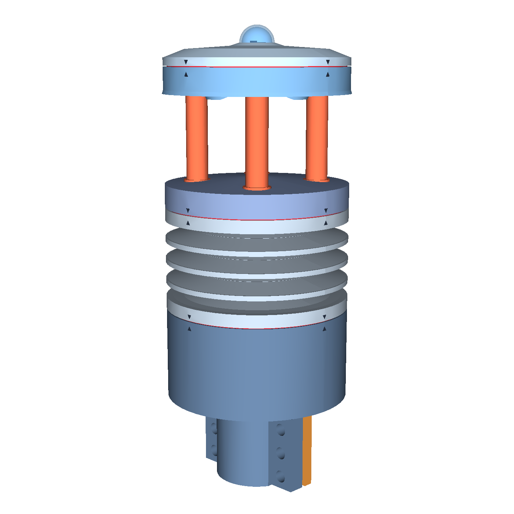
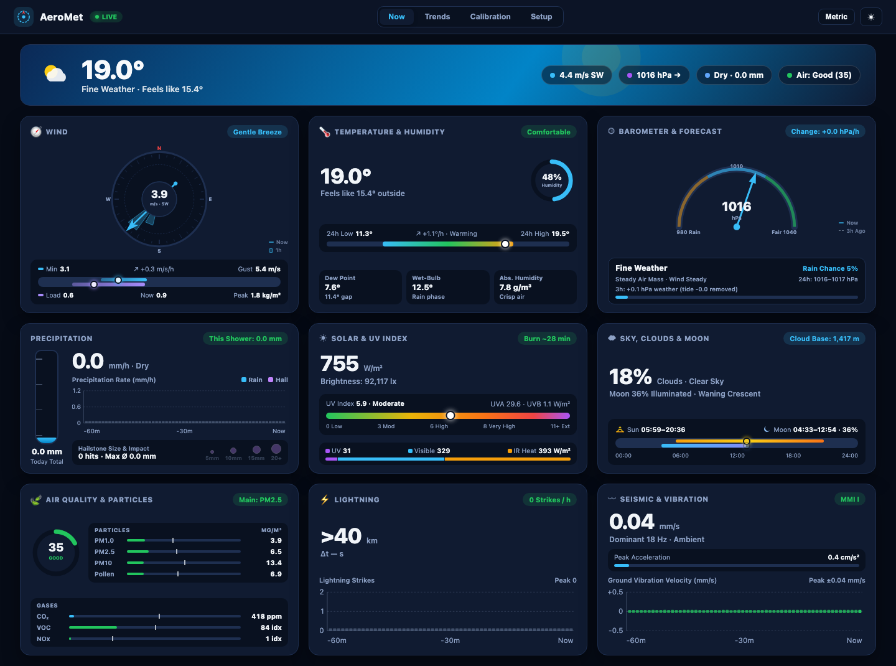
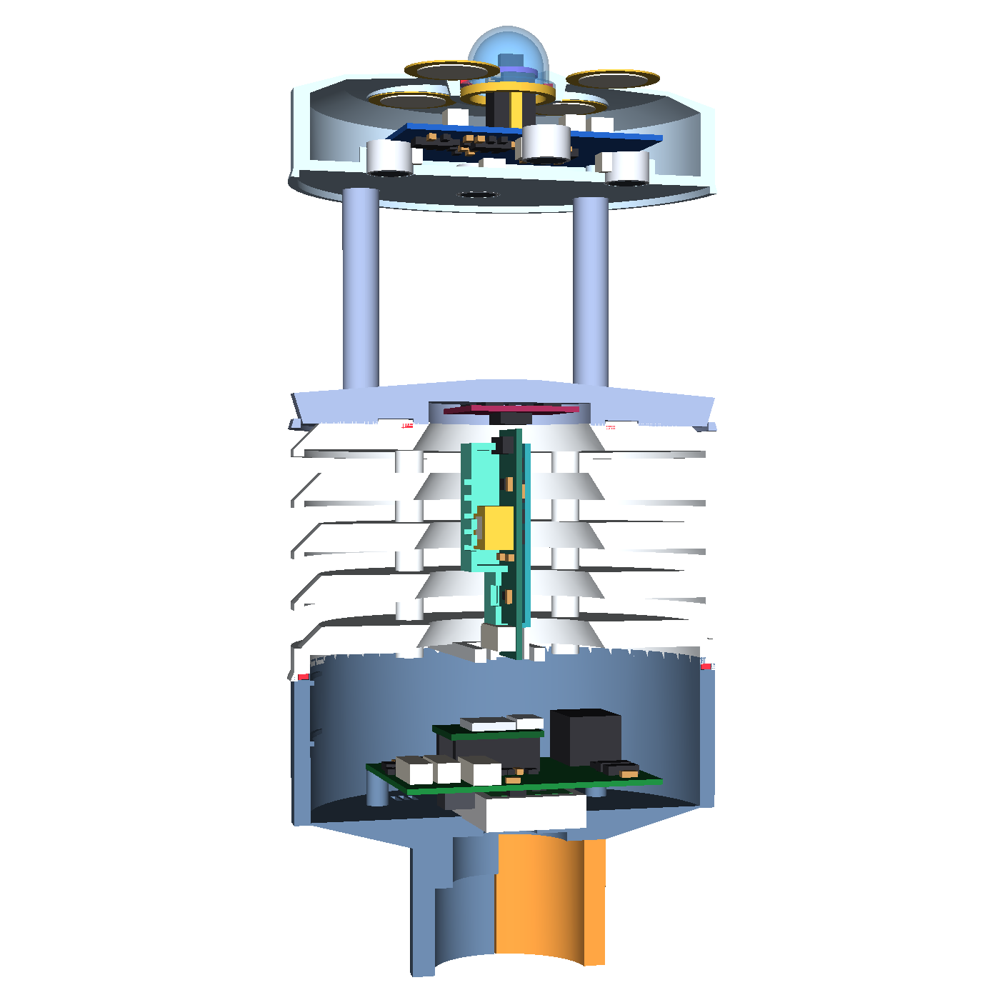
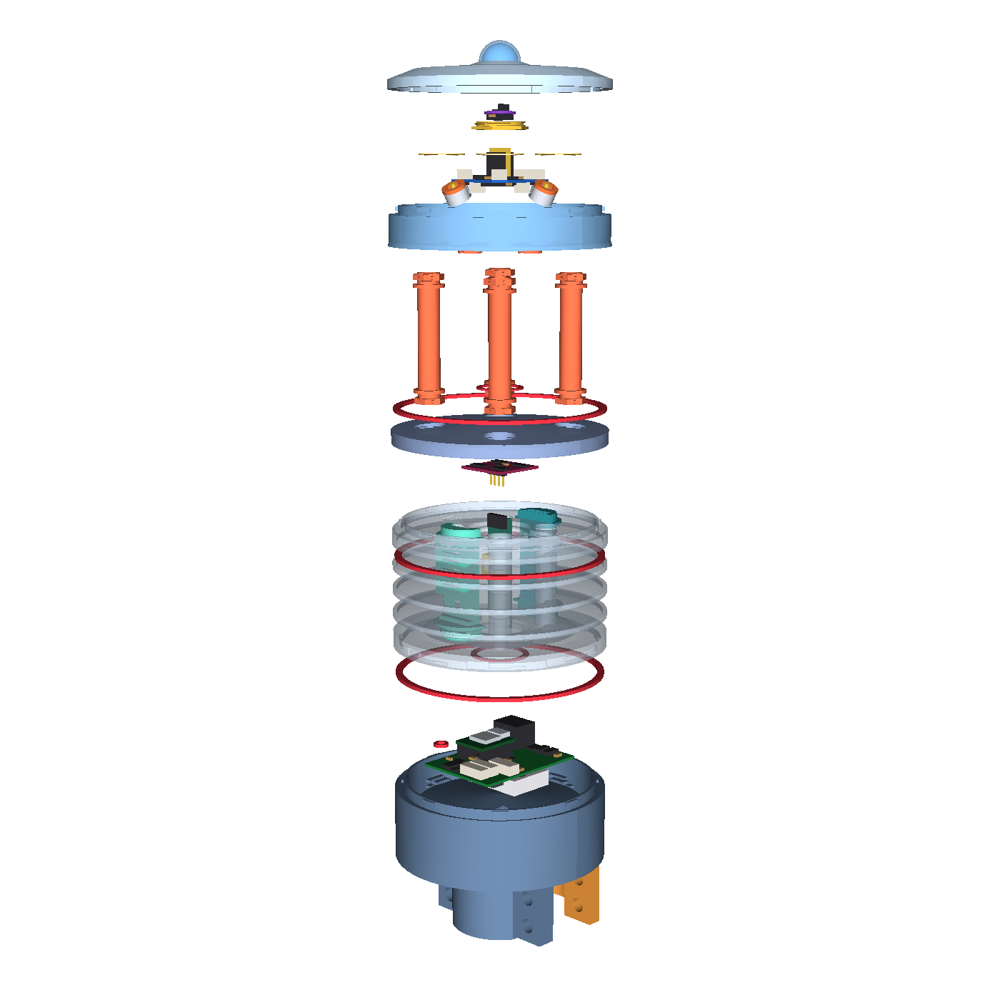
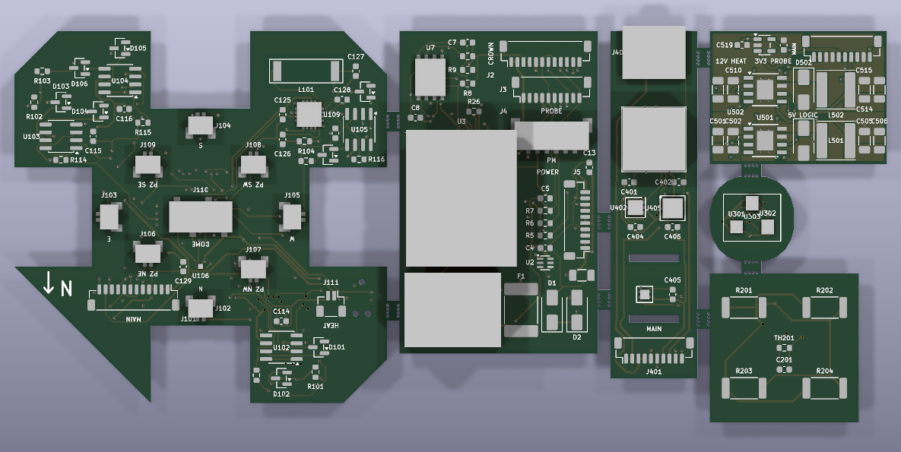
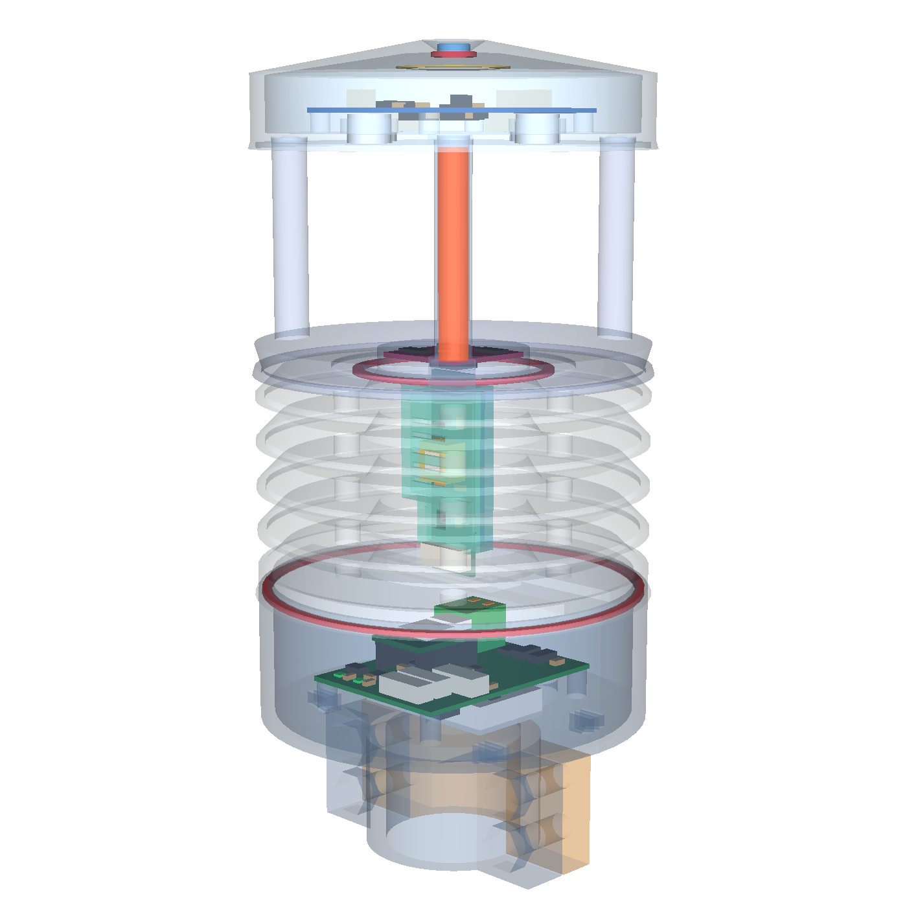
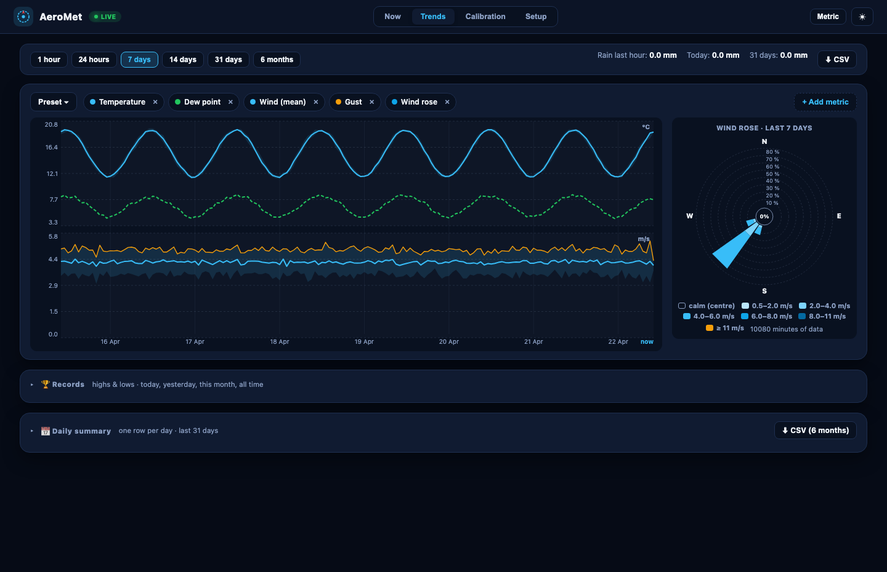
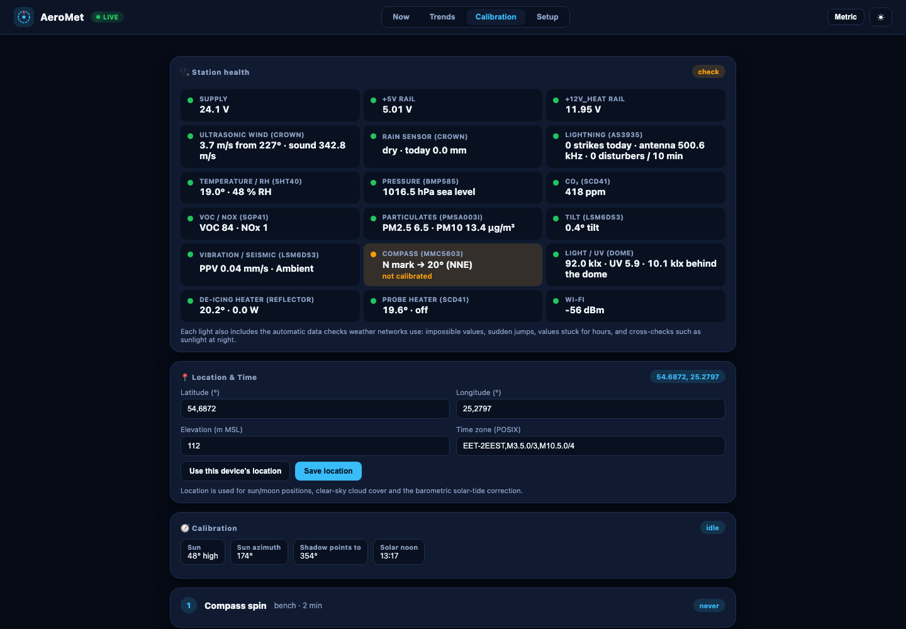
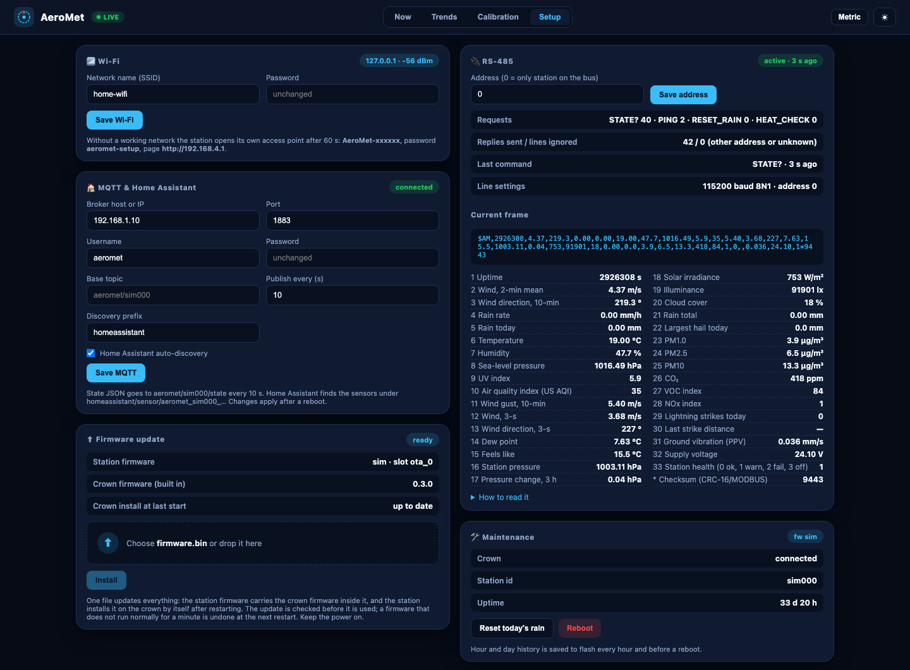

# AeroMet V1 — Solid-State Roof Weather & Air-Quality Station

[](https://github.com/vbartusevicius/weather-station/actions/workflows/ci.yml)

Open-source rooftop weather and air-quality station with **no moving parts** (`Ø 96 × 235 mm`, UV-stabilised ASA):
ultrasonic wind, acoustic rain and hail, UV / sunlight / night-sky brightness, temperature, humidity, pressure, lightning,
PM1 / PM2.5 / PM10, VOC / NOx and true CO₂. It runs from `12–32 V DC`, talks Wi-Fi and RS-485, serves its own web
dashboard and appears in Home Assistant by itself.

<table>
  <tr>
    <td width="34%"></td>
    <td width="66%"></td>
  </tr>
</table>

[What it measures](#what-it-measures) · [Hardware](#hardware) · [Web UI](#web-ui) · [Build one](#build-one) ·
[Firmware](#firmware) · [Development](#development)

## What it measures

| Measurement | Sensor | Range |
| :--- | :--- | :--- |
| Wind speed & direction | 4× 40 kHz ultrasonic transducers, time of flight (STM32G431 crown) | 0–60 m/s, 0.1° |
| Rain & hail | 4 piezo discs under the lid, acoustic impacts | 0–200 mm/h, hail size |
| UV index, sunlight, night sky | LTR-390UV + GUVB-C31SM + TSL25911 under a PTFE dome | UVI 0–16+, 0.0002–157 000 lx |
| Temperature & humidity | Sensirion SHT40 in a 5-plate radiation shield | ±0.2 °C, ±1.8 % RH |
| Pressure & thunder | Bosch BMP585 | ±0.06 hPa |
| Particulates | Plantower PMSA003I | PM1 / PM2.5 / PM10 |
| VOC & NOx | Sensirion SGP41 + Gas Index Algorithm | index 1–500 |
| CO₂ | Sensirion SCD41 (heated below −8 °C) | 400–5000 ppm |
| Lightning | AS3935 + 500 kHz ferrite antenna | 1–40 km |
| Compass, tilt, vibration | MMC5603 + LSM6DS3 | heading, mast tilt, ground vibration |

Full sensor, enclosure and board reference: **[docs/hardware.md](docs/hardware.md)**.

## Hardware

| Cutaway | Exploded | Six boards on one breakaway panel |
| :---: | :---: | :---: |
|  |  |  |
| radiation shield, probe cartridge, base bay | 13 printed parts, bayonet and threaded joints | crown, main, probe, power, dome, reflector (4-layer, 140.6 × 63.2 mm) |

<details>
<summary><b>More renders</b>: inside view, every printed part, board plots</summary>

| Inside | Base | Pagoda | Wind tunnel |
| :---: | :---: | :---: | :---: |
|  |  |  |  |
| **Crown base** | **Crown lid** | **Struts** | **Probe sleeve** |
|  |  |  |  |

Board plots (top / bottom SVG): [crown](hardware/releases/v1/crown/renders/top.svg) ·
[main](hardware/releases/v1/main/renders/top.svg) · [probe](hardware/releases/v1/probe/renders/top.svg) ·
[power](hardware/releases/v1/power/renders/top.svg) · [dome](hardware/releases/v1/dome/renders/top.svg) ·
[reflector](hardware/releases/v1/reflector/renders/top.svg) · [panel](hardware/releases/v1/panel/renders/top.svg)

</details>

## Web UI

The station serves its dashboard over Wi-Fi (no cloud, no app). Every value is computed by the firmware; the page only
displays it.

| Now | Trends |
| :---: | :---: |
| [](docs/images/webui_now.png) | [](docs/images/webui_trends.png) |
| live readings, forecast, sun & moon, air quality, lightning | any metrics from 1 hour to 6 months, wind rose, records, CSV export |
| **Calibration** | **Setup** |
| [](docs/images/webui_calibration.png) | [](docs/images/webui_setup.png) |
| station health, home calibration with household items | Wi-Fi, MQTT / Home Assistant, RS-485 monitor, firmware update |

Also: MQTT with Home Assistant auto-discovery, and an RS-485 poll / response protocol (CRC-16 frames with every
sensor) for wired loggers.

## Build one

1. **Order the boards**: one 4-layer breakaway panel at JLCPCB (Gerbers, BOM, CPL in
   [`hardware/releases/v1/panel/`](hardware/releases/v1/panel/)); a few parts are hand-fitted.
2. **Print the enclosure**: 8 print plates in [`enclosure/print/`](hardware/releases/v1/enclosure/print/) (MJF / SLS
   nylon or ASA), plus standard O-rings and a turned PTFE dome.
3. **Assemble and seal**: harnesses, conformal coating and sealing in **[docs/building.md](docs/building.md)**.
4. **Flash** the station once over USB, then **bring it up and calibrate** it at home:
   **[CALIBRATION.md](CALIBRATION.md)**.

Open design questions and acceptance checks: [REVIEW_CHECKLIST.md](REVIEW_CHECKLIST.md).

## Firmware

Download from **[Releases](https://github.com/vbartusevicius/weather-station/releases)**: each release carries the
firmware and the complete hardware package (`aeromet-hardware-v1.zip`: Gerbers, BOM, CPL, STL / STEP print plates,
drawings, build and calibration guides). Every commit to `main` that passes CI is released, named after its UTC commit
time (`2026.10.24.0040`); the firmware reports the same version.

| File | Use |
| :--- | :--- |
| `usb-flash-firmware.bin` | first flash of a new board over USB: `esptool.py --chip esp32c6 write_flash 0x0 usb-flash-firmware.bin` |
| `firmware.bin` | later updates from the Web UI (Setup → Firmware update); carries the crown firmware too |

The version is the UTC commit time, `yyyy.mm.dd.hhmm`. Local build: `python3 station/scripts/release_firmware.py`
→ `station/build/firmware/`.

## Development

| Folder | Contents |
| :--- | :--- |
| [`hardware/`](hardware/) | spec (`product/spec.yaml`), SKiDL circuits, KiCad layouts, simulations, release package |
| [`mechanical/`](mechanical/) | CadQuery enclosure generator and renderer |
| [`station/`](station/) | ESP32-C6 firmware (ESP-IDF), Web UI (`station/data/`), simulator, unit and Web UI tests |
| [`crown/`](crown/) | STM32G431 crown firmware (ultrasonic wind, rain, lightning) |

```bash
python3 hardware/scripts/build.py                     # everything: hardware, CAD, release, firmware, tests
docker compose --profile lint run --rm -T cpp-lint "pio test -d station -e native"   # firmware unit tests
python3 station/scripts/mock_webui_server.py          # Web UI on the simulator: http://127.0.0.1:8765
docker compose --profile lint run --rm lint check .   # lint
python3 docs/render_readme_images.py                  # refresh the README screenshots and PCB render
```

Architecture, conventions and every command: [AGENTS.md](AGENTS.md).
