# AeroMet V1 — Hardware Reference

Sensors, the 13-part enclosure and the six PCBs in detail. Overview and pictures: [README](../README.md); ordering,
printing and weatherproofing: [building.md](building.md); bring-up and calibration: [CALIBRATION.md](../CALIBRATION.md).

## Measured Parameters & Hardware Architecture

<b>Wind Speed & Direction</b> · 4 ultrasonic transducers, time of flight · 0–60 m/s, 0.1°

- **Sensor / circuit:** 4× `40 kHz` waterproof ultrasonic transducers + crown `STM32G431` (4× `UCC27524` H-bridge, ≈ `21.8 Vpp` from `+12V_HEAT`, `BAV99` T/R isolation, `74HC4052` + `TLV9062` + PGA, 2 MSPS echo sampling, envelope + reciprocal cross-correlation timing)
- **Range & resolution:** `0–60 m/s` (`0.01 m/s`), `0–359.9°` (`0.1°`), `4 Hz`
- **Location & protection:** Downward-facing in `crown.stl` across a `48 mm` vertical wind gap (`D = 54 mm` span).

<b>Compass & Mast Tilt</b> · MMC5603NJ compass + LSM6DS3TR-C IMU · ±0.5° heading, ±0.1° tilt

- **Sensor / circuit:** `MEMSIC MMC5603NJ` 20-bit AMR compass + `ST LSM6DS3TR-C` 6-axis IMU
- **Range & resolution:** `±0.5°` heading, `±0.1°` tilt
- **Location & protection:** Auto-aligns wind direction to North and subtracts pole vibration from the rain sensor.

<b>Rain & Hail</b> · 4 piezo discs under the lid · 0–200 mm/h, hail size

- **Sensor / circuit:** 4× `20 mm` `Murata 7BB-20-6L0` piezo discs in parallel + `TLV9062` charge/envelope amp
- **Range & resolution:** `0–200 mm/h`, `0.01 mm` step, hail hit counter
- **Location & protection:** Bonded to four `1.0 mm`-thin ceiling pockets in `crown.stl` (`45°, 135°, 225°, 315°`).

<b>UV-A/B, Solar & Night Sky</b> · GUVB-C21SD + GUVA-C22SD photodiodes + TSL25911 under a PTFE dome · UVI 0–16+, 0.0002–88 000 lx

- **Sensor / circuit:** Genicom `GUVB-C21SD` UV-B (`D1`) + `GUVA-C22SD` UV-A (`D2`) photodiodes → `TLV9062` transimpedance → `ADS1115` (I²C 0x49), + `ams OSRAM TSL25911FN` (`U2`). Backup board `dome_legacy`: `LTR-390UV-01` + `TSL25911FN` + `GUVB-C31SM`
- **Range & resolution:** `UVI 0–16+`, `0.00018–157,000 lx`, `NIR 700–1100 nm`
- **Location & protection:** Mounted on the elevated round `dome` PCB under a turned PTFE dome diffuser with a flat-faced `Ø 20.4 × 1.5 mm` flange (the `18 × 1.0 mm` O-ring is squeezed flat between the flange top and the collar lip; the nut pushes the flat flange bottom) in two shapes: **lathe** version (default: `Ø 17.8 mm` cylinder with a flat top, turned from round rod) and **CNC** version (`Ø 17.8 mm` hemisphere), both `0.8 mm` wall (~10–12 % flat 250–2500 nm transmission, calibrated per CALIBRATION.md step 8), in a low flush collar: nothing of the lid rises within 3° of the sensors' horizon, so they see sunrise / sunset. The stock `Ø 20 × 2 mm` `JGS1` window in the `crown_window` top is the backup (sky above ~19–34° only). The UV-B photodiode is the UV-index source.

<b>Temperature & Humidity</b> · Sensirion SHT40 · −40…+85 °C ±0.2 °C, 0–100 % RH

- **Sensor / circuit:** `Sensirion SHT40-AD1F-R2` with factory IP67 PTFE membrane
- **Range & resolution:** `-40..+85 °C` (`±0.2 °C`), `0–100% RH` (`±1.8%`)
- **Location & protection:** Bottom tip of `probe` PCB between two milled thermal slots (ground plane cut on the heater side), as far from the SCD41 heater as the board allows, exposed through a `4.6 × 4.6 mm` window in `probe_sleeve_front.stl`.

<b>Barometric Pressure & Thunder</b> · Bosch BMP585 · 300–1250 hPa, thunder pressure waves

- **Sensor / circuit:** `Bosch BMP585` (gel-filled, liquid-resistant)
- **Range & resolution:** `300–1,250 hPa` (`±0.06 hPa` relative, `< 0.1 Pa RMS`), thunder pressure waves
- **Location & protection:** Middle section of `probe` PCB (`U5`) in the vented probe chamber, directly behind a sleeve vent slot; dynamic wind-pressure (Bernoulli) compensation.

<b>Particulate Matter</b> · Plantower PMSA003I · PM1 / PM2.5 / PM10

- **Sensor / circuit:** `Plantower PMSA003I` (I²C, outdoor-proven fan + laser counter)
- **Range & resolution:** $\text{PM}_{1.0}, \text{PM}_{2.5}, \text{PM}_{10}$ (`µg/m³`)
- **Location & protection:** Lies face-down on the left half of the `base.stl` bay beside `main`, on two sealed duct chambers whose `1.2 mm` floor slits draw (front-left) and exhaust (rear-left) outside air only; harness to `main J4`.

<b>VOC & NOx</b> · Sensirion SGP41 · VOC / NOx index 1–500

- **Sensor / circuit:** `Sensirion SGP41-D-R4` + Sensirion Gas Index Algorithm `3.2.3`
- **Range & resolution:** VOC Index (`1–500`), NOx Index (`1–500`)
- **Location & protection:** Middle section of `probe` PCB (`U2`) behind a sleeve vent slot.

<b>True CO₂</b> · Sensirion SCD41 with winter heater · 400–5000 ppm

- **Sensor / circuit:** `Sensirion SCD41-D-R2` (rated `−10…+60 °C`) + closed-loop `−7.6 °C` backside heater (`2× 680 Ω 1206` on `+12V_HEAT`, `0.42 W`, + `LM2903` on `+12V_HEAT` with `~2.3 K` hysteresis + `TH1`; off above `−8 °C` so it cannot warm the SHT40 in the common winter range)
- **Range & resolution:** `400–5,000 ppm`
- **Location & protection:** Top section of `probe` PCB next to `J2`; backside pocket in `probe_sleeve_back.stl` traps warmth in winter.

<b>Lightning Detector</b> · AS3935 + MA5532 ferrite antenna · 1–40 km

- **Sensor / circuit:** `ScioSense AS3935-BQFT` on the crown STM32 SPI bus + `Coilcraft MA5532-AE` `100 µH` ferrite-rod antenna / `2× 470 pF C0G` `500 kHz` tank (AS3935-AN04; no copper under the antenna, automatic `TUN_CAP` tuning; events during a transducer burst are flagged)
- **Range & resolution:** `1–40 km` storm distance & strike count
- **Location & protection:** SW edge of the `crown` PCB, far from the base-bay bucks and the ESP32.

<b>Wind-Tunnel De-Icer</b> · 4 resistors on the reflector board · 4.5 W regulated

- **Sensor / circuit:** 4× `120 Ω` `2512` `2 W` parallel resistors on `+12V_HEAT` (`30 Ω`, `4.8 W` max at 12 V) + `10k` NTC `TH1` (open-NTC lockout in firmware)
- **Range & resolution:** Constant `4.5 W` PWM on the measured rail (12 V from ≈ 13.5 V input up; on a 12 V supply the rail passes through at ≈ 10.4–11 V and the heater delivers ≈ 3.6 W), current measured by the `ADS1115`
- **Location & protection:** Horizontal `reflector` PCB (`24 × 24 mm`) seated directly under the ultrasonic reflector cone.

<b>Power & Connectivity</b> · 12–32 V input, 2 bucks, ESP32-C6, RS-485 · Wi-Fi + 115 200 bps

- **Sensor / circuit:** `KF250-3.5-4P` terminal (`J1`, `60 V` PTC + `SMAJ36A` TVS) + `power` board (2× `TPS54360` `60 V` buck at `743 kHz`: `+5V` electronics, `+12V_HEAT` heaters + transducer drive) + `XIAO ESP32-C6` + `SP3485EN` RS-485 (+ `SM712` surge TVS)
- **Range & resolution:** `12–32 V DC`, Wi-Fi 6 (`+20.5 dBm` + U.FL dipole) + `115,200 bps` RS-485
- **Location & protection:** All 4 wires of the roof cable (`VIN+`, `GND`, `RS485_A`, `RS485_B`) terminate in `main J1`.

---

## Modular 3D-Printed Enclosure (`hardware/releases/v1/enclosure/`)

The enclosure is split into **13 modular parts** printed from 8 print plates: `base`, `orings`, `pagoda`, `wind_tunnel`, `probe_sleeve` (front + back), `mast_clamp` (+ `mast_shims`), `struts` (+ `transducer_adapters`), `crown` (+ `crown_window` + `crown_base`) in [`enclosure/print/`](../hardware/releases/v1/enclosure/print/) — every body laid out `≥ 6 mm` apart; never print the assembled multi-body STLs) using **8-lug Push-Turn-Click Bayonet Interlocks (`20.5°` / `~19 mm` turn travel with O-ring pre-load and a `0.47 mm` anti-unscrew detent step)** on the three main outer housing rings so internal wires never twist during assembly, while using **true right-hand helical screw threads** on the `probe_sleeve` bottom watertight bulkhead, the 4 split-C struts, and the UV-dome retainer nut.

<b>1. base</b> · Sealed lower electronics bay

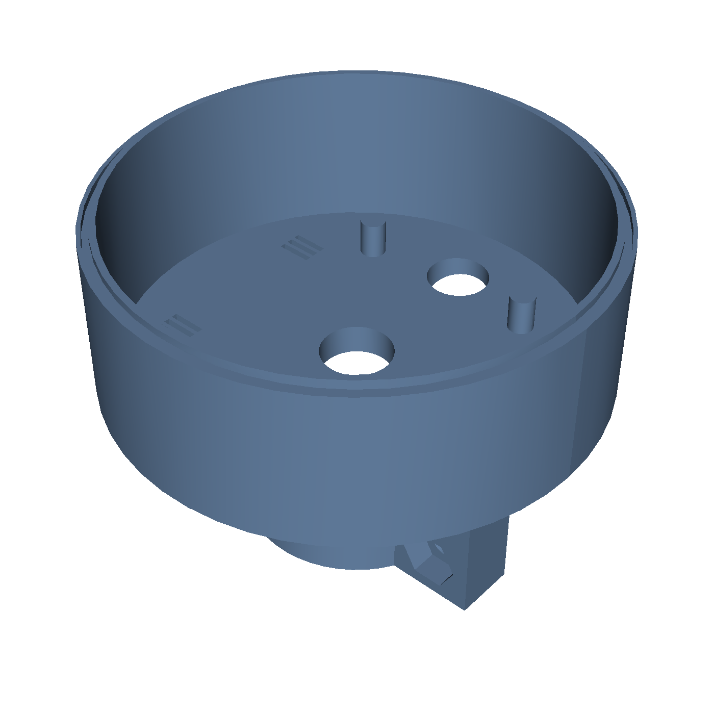

**Files:** [`base.stl`](../hardware/releases/v1/enclosure/base.stl) · [`base.step`](../hardware/releases/v1/enclosure/base.step) · [bay floor](../hardware/releases/v1/enclosure/renders/base_floor.png) · [underside](../hardware/releases/v1/enclosure/renders/base_underside.png)

Sealed lower electronics bay: `main` PCB on the right half, the `PMSA003I` particulate module lying face-down on the left half on two sealed duct chambers (floor slits to the outside, 2 snap hooks). The bay is `15 mm` taller than the original design (`y = 34.5..85.2 mm`): `power` board `6 mm` above the floor, `main` `9.8 mm` above the power board's inductors, PMSA003I face `11 mm` above the floor on tall duct chambers with a roofed intake duct reaching `6 mm` further from the exhaust. Includes an **internal conical Drip Umbrella Canopy (`y = 69.2..74.0 mm`)** over the `main` PCB, a **bottom-protruding REBOOT / FACTORY-RESET button plunger (`x = +18.5, z = -20.0 mm` under `SW1`; captive, laid out on `print/base.stl`; its bore is not sealed)**, 4× 4-slit `1.2 mm` bottom micro-grilles + perimeter weep drains, 8 free-standing PCB edge snap-clips (4 for `main`, 4 for `power`, each ≥ 1 mm clear of the wall so it can flex), (no antenna cradle: stick the U.FL dipole to the inner wall with its adhesive), a center `M12 / PG7` cable-gland hole, and 8 external bayonet lugs (`y = 81.4..84.9 mm`). Every part above the base is listed in its design coordinates below and sits `15 mm` higher when assembled.
 

<b>2. mast_clamp</b> · Detachable front pole saddle (40 mm tall, 6× Ø 6.4 mm M6 bolt holes in 3 rows) with flat outer seating…

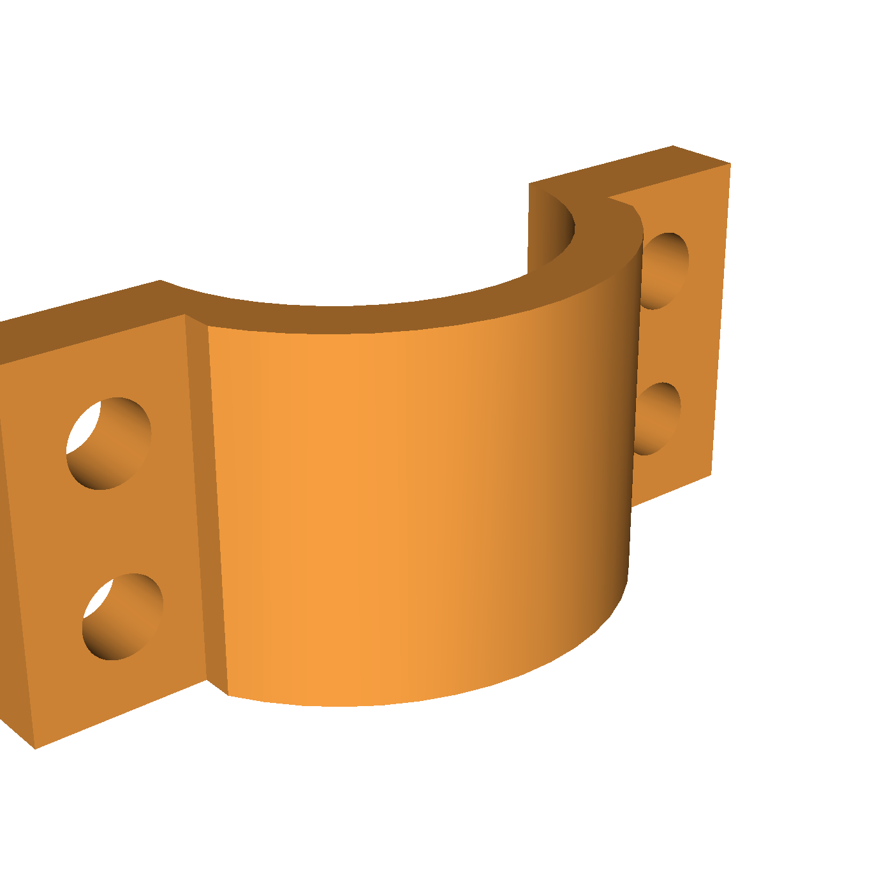

**Files:** [`mast_clamp.stl`](../hardware/releases/v1/enclosure/mast_clamp.stl) · [`mast_clamp.step`](../hardware/releases/v1/enclosure/mast_clamp.step)

Detachable front pole saddle (`40 mm` tall, `6× Ø 6.4 mm` M6 bolt holes in 3 rows) with flat outer seating faces for M6 bolts and `Ø 12 mm` washers. `31 mm` pole engagement, `2.0 mm` closing travel: grips `Ø 32–34 mm` poles directly, `Ø 24–32 mm` poles with the `mast_shims` (part 11).
 

<b>3. orings</b> · Five elastomeric rings (buy standard EPDM/NBR 70A O-rings; TPU prints are a fallback)

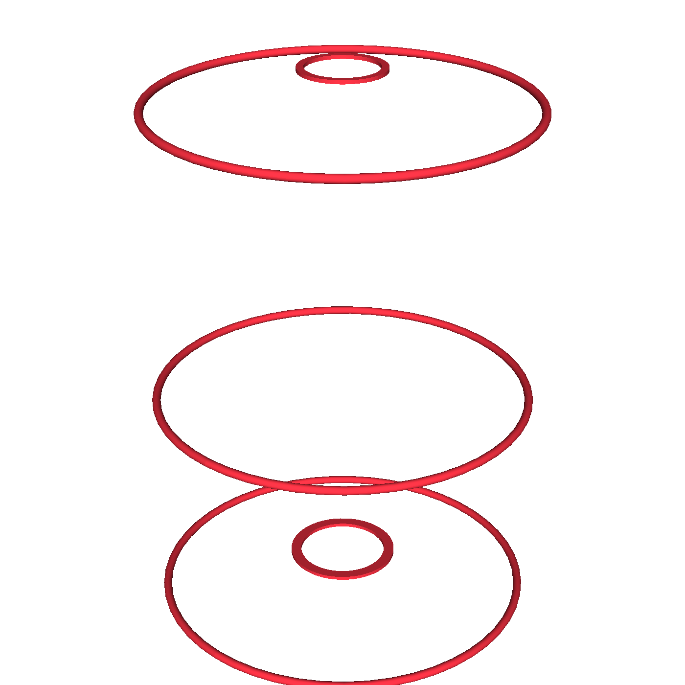

**Files:** [`orings.stl`](../hardware/releases/v1/enclosure/orings.stl) · [`orings.step`](../hardware/releases/v1/enclosure/orings.step)

Five elastomeric rings (buy standard EPDM/NBR 70A O-rings; TPU prints are a fallback): three `88 × 2.0 mm` bayonet face seals (`base ↔ pagoda`, `pagoda ↔ wind_tunnel`, `crown_base ↔ crown`; glands give `15 %` squeeze at rest and `38 %` while pushing through the detent — a `1.5 mm` ring does not seal), one `21 × 1.5 mm` `probe_sleeve` bottom seal, one `18 × 1.0 mm` UV-dome flange seal (`17 × 1.0 mm` for the backup `crown_window` top).
 

<b>4. probe_sleeve_back</b> · Rear half of the probe PCB cartridge

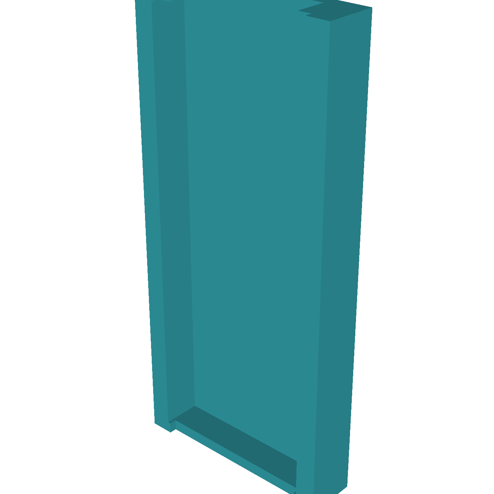

**Files:** [`probe_sleeve_back.stl`](../hardware/releases/v1/enclosure/probe_sleeve_back.stl) · [`probe_sleeve_back.step`](../hardware/releases/v1/enclosure/probe_sleeve_back.step)

Rear half of the `probe` PCB cartridge. Features a close-fitting (`0.10 mm` clearance) PCB pinch dam with a grease/sealant reservoir groove at the bottom, a dedicated `12.6 × 3.35 mm` vertical rear cable conduit for the 10-wire `crown` cable, a smooth press-fit top spigot, and the rear half of the bottom ISO `M22 × 1.5` helical thread.
 

<b>5. probe_sleeve_front</b> · Front half of the probe cartridge

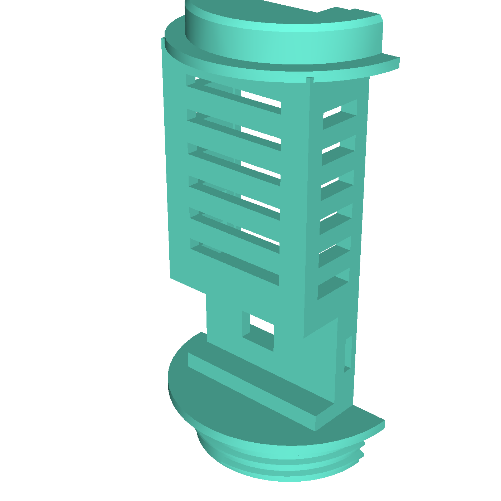

**Files:** [`probe_sleeve_front.stl`](../hardware/releases/v1/enclosure/probe_sleeve_front.stl) · [`probe_sleeve_front.step`](../hardware/releases/v1/enclosure/probe_sleeve_front.step)

Front half of the `probe` cartridge. Fully encloses `probe J1` on the front (zero external notch), pinches within `0.10 mm` of the PCB above `J1` with a grease/glue groove, screws watertight into `pagoda`'s bottom deck via the ISO `M22 × 1.5` helical thread, and press-fits into `pagoda`'s upper collar. Air reaches the sensors through a `4.6 × 4.6 mm` `SHT40` window, a uniform grid of 6 slots over the `SGP41` / `BMP585` (slot at `y = 96.5`) and the `SCD41` above them, and 6 side slots per side that let the shield airflow cross the upper chamber.
 

<b>6. pagoda</b> · Bolted 5-plate Stevenson radiation shield (y = 66.9..123.9 mm)

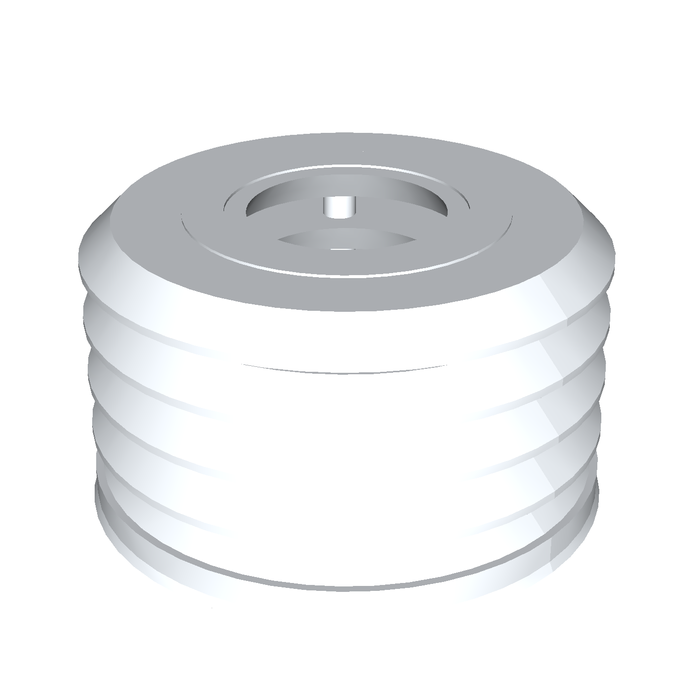

**Files:** [`pagoda.stl`](../hardware/releases/v1/enclosure/pagoda.stl) · [`pagoda.step`](../hardware/releases/v1/enclosure/pagoda.step)

Bolted 5-plate Stevenson radiation shield (`y = 66.9..123.9 mm`). Clamped by 4× DIN 7984 low-head `M6 × 55 mm` stainless through-bolts (`at r = 20.5 mm`; a standard ISO 4762 head hits the `reflector` board) inside `Ø 10.0 mm OD / Ø 6.2 mm ID` spacer columns, `1.6 mm`-thick louver blades with interlocking male/female spigots and recessed top bolt-head wells, plus **4× 3-slit `1.2 mm` top ventilation & moisture-dissipation micro-grilles** sheltered under the 5th louver.
 

<b>7. wind_tunnel</b> · Compact heated conical ultrasonic reflector deck (y = 120.6..136.0 mm)

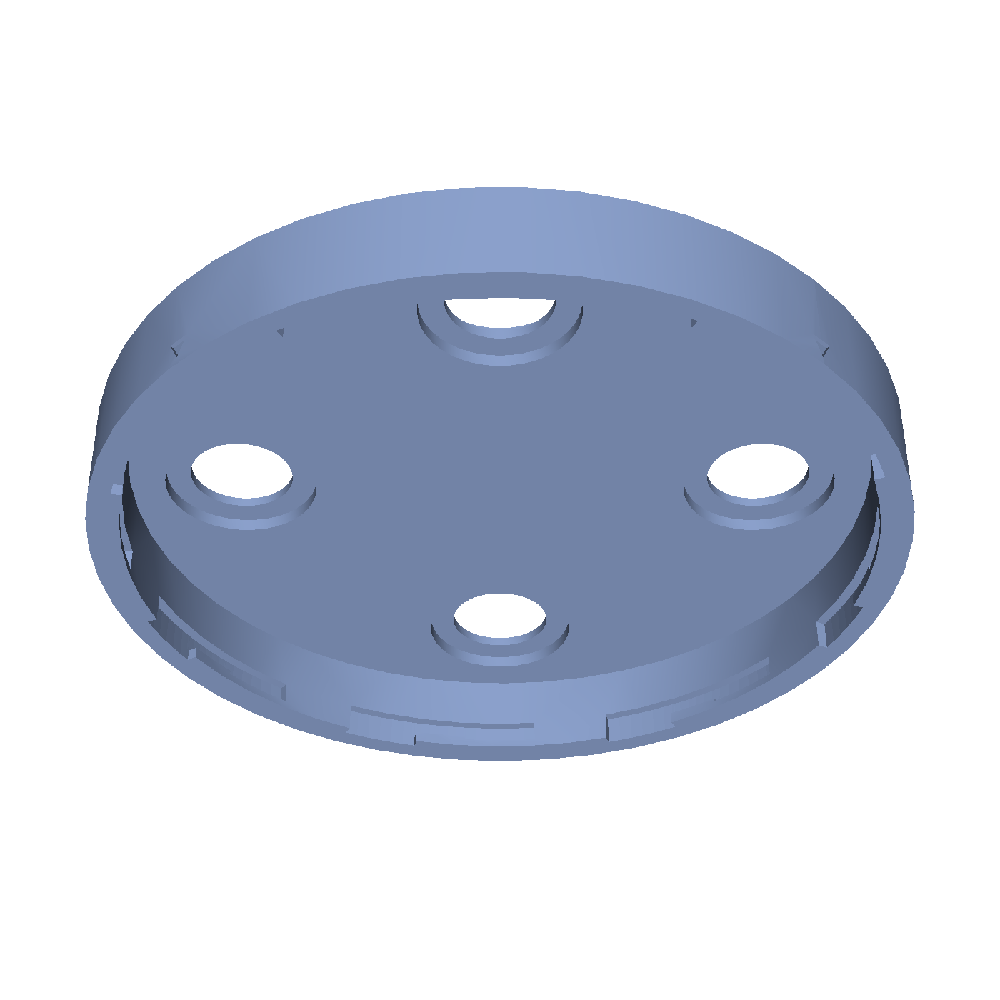

**Files:** [`wind_tunnel.stl`](../hardware/releases/v1/enclosure/wind_tunnel.stl) · [`wind_tunnel.step`](../hardware/releases/v1/enclosure/wind_tunnel.step)

Compact heated conical ultrasonic reflector deck (`y = 120.6..136.0 mm`). Locks onto the top of `pagoda.stl` via an 8-lug internal Push-Turn-Click bayonet whose skirt leaves a `10.4 mm` crown-cable gap above the pagoda deck, sits in flush thermal contact (`y = 130.48 mm`) with the `24 × 24 mm` `reflector` heater resistors, and routes the `45°` NE strut cable radially inward to `probe_sleeve_back`.
 

<b>8. struts</b> · Four separate Double-C split hollow threaded tubes (8 C-shaped halves, Ø 5.8–6.0 mm internal cable bore)…

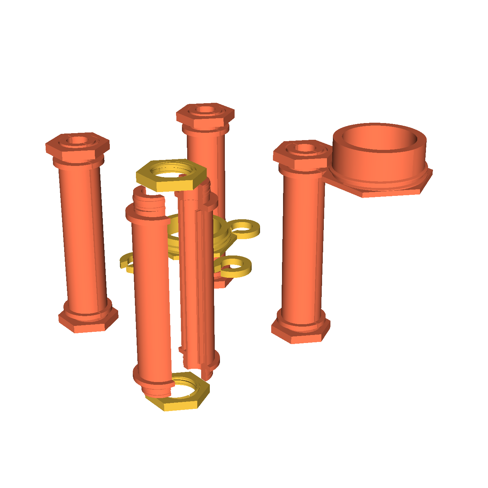

**Files:** [`struts.stl`](../hardware/releases/v1/enclosure/struts.stl) · [`struts.step`](../hardware/releases/v1/enclosure/struts.step)

Four separate **Double-C split hollow threaded tubes** (`8 C-shaped halves`, `Ø 5.8–6.0 mm` internal cable bore) with `Ø 14.0 mm` top and bottom flange stoppers (`y = 126.5` and `174.0 mm`), **`M12 × 1.75` external helical threaded ends**, and **8 printed `M12 × 1.75` hex locknuts (`15 mm` AF, `1.28 mm` wall at the flats; pockets are too small for metal ISO nuts)**.
 

<b>9. crown_base</b> · Lower ultrasonic transducer & crown PCB tray (y = 172.5..189.8 mm)

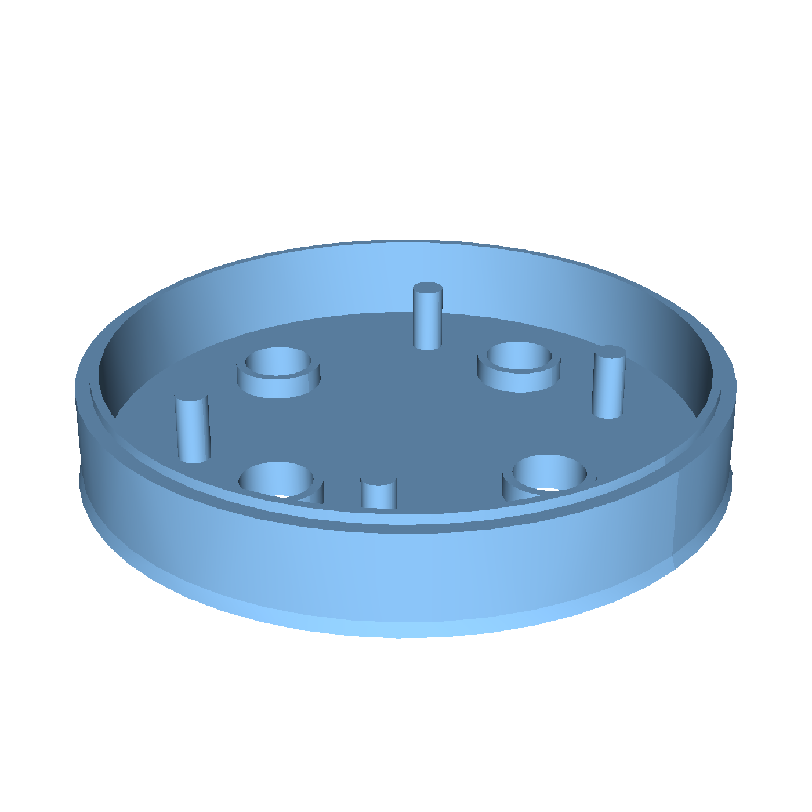

**Files:** [`crown_base.stl`](../hardware/releases/v1/enclosure/crown_base.stl) · [`crown_base.step`](../hardware/releases/v1/enclosure/crown_base.step)

Lower ultrasonic transducer & `crown` PCB tray (`y = 172.5..189.8 mm`). Open on top so you can tighten the 4 top `M12 × 1.75` strut hex locknuts, install the 4 downward `40 kHz` transducers, and snap in the `crown` PCB before locking on `crown.stl` via the upper `Ø 88 mm` O-ring and 8-lug Push-Turn-Click bayonet (`20.5°` turn).
 

<b>10. crown</b> · Removable top piezo rain & UV dome lid (y = 186.5..198.0 mm)

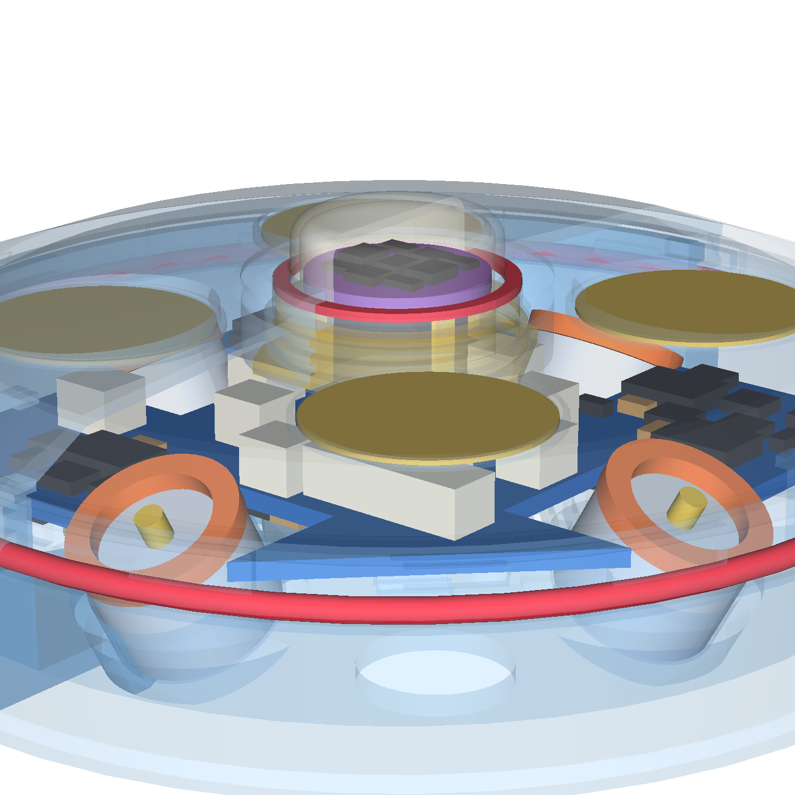

**Files:** [`crown.stl`](../hardware/releases/v1/enclosure/crown.stl) · [`crown.step`](../hardware/releases/v1/enclosure/crown.step)

Removable top piezo rain & UV dome lid (`y = 186.5..198.0 mm`). Locks onto `crown_base.stl` via an 8-lug internal Push-Turn-Click bayonet, holds the 4× `20 mm` Murata piezo discs under `1.0 mm`-thin ceiling pockets, and takes the UV cover in the centre. **Two crown tops** (both on the `crown` print plate): `crown` (default) holds a turned PTFE dome diffuser with a flat-faced `Ø 20.4 × 1.5 mm` flange (the `18 × 1.0 mm` O-ring is squeezed flat between the flange top and the collar lip; the nut pushes the flat flange bottom) in two shapes: **lathe** version (default: `Ø 17.8 mm` cylinder with a flat top, turned from round rod) and **CNC** version (`Ø 17.8 mm` hemisphere), both `0.8 mm` wall ([lathe drawing](../hardware/releases/v1/enclosure/drawings/ptfe_dome_lathe.svg) / [STEP](../hardware/releases/v1/enclosure/ptfe_dome_lathe.step), [CNC drawing](../hardware/releases/v1/enclosure/drawings/ptfe_dome_cnc.svg) / [STEP](../hardware/releases/v1/enclosure/ptfe_dome_cnc.step); [CNC render](../hardware/releases/v1/enclosure/renders/crown_dome_cnc.png)) in a low flush collar (`0.9 mm` lip, lid apex trimmed `1.0 mm` under the sensor tops, so the sensors see down to below the horizon). [`crown_window`](../hardware/releases/v1/enclosure/crown_window.stl) (backup) holds the stock `Ø 20 × 2 mm` `JGS1` window in a raised boss (`1.2 mm` chamfered lip, 4 drains; [render](../hardware/releases/v1/enclosure/renders/crown_window.png)). In both, a thin `1.0 mm` O-ring seals the lid against the cover, and a printed `M22 × 1.5` nut (both nuts are on the `struts` plate) pushes the cover up from below.
 

<b>11. mast_shims</b> · Four pairs of split reducer half-shells (1 / 2 / 3 / 4 mm wall, 31 mm tall) for Ø 30–32, 28–30, 26–28 and…

**Files:** [`mast_shims.stl`](../hardware/releases/v1/enclosure/mast_shims.stl) · [`mast_shims.step`](../hardware/releases/v1/enclosure/mast_shims.step)

Four pairs of split reducer half-shells (`1 / 2 / 3 / 4 mm` wall, `31 mm` tall) for `Ø 30–32`, `28–30`, `26–28` and `24–26 mm` poles.

<b>12. transducer_adapters</b> · Four slotted press-fit rings that lock the default Ø 14 × 9 mm Same Sky CUSA-TR65-065-2200-TH68…

**Files:** [`transducer_adapters.stl`](../hardware/releases/v1/enclosure/transducer_adapters.stl) · [`transducer_adapters.step`](../hardware/releases/v1/enclosure/transducer_adapters.step)

Four slotted press-fit rings that lock the default `Ø 14 × 9 mm` Same Sky `CUSA-TR65-065-2200-TH68` transducers into the `Ø 14.6 mm` barrels, plus four optional sleeves for `Ø 10 × 7 mm` transducers (laid out beside the station).

---

## 6-Board PCB Stack on One Breakaway Panel (`hardware/releases/v1/`)

All six 4-layer `1.6 mm` PCBs are packed onto one **`140.6 × 63.2 mm` mouse-bite breakaway panel** (`crown`, `main`, the vertical `probe`, and a column of `reflector`, `dome` and `power`; `0 DRC errors`, 92 consolidated BOM lines, 206 SMT placements, every board held by ≥ 2 tabs placed ≥ 1 mm from parts). The panel has no own rails or fiducials: order it with **"Edge rails / fiducials: added by JLCPCB"**. Each board also has its own release folder (Gerbers, BOM, CPL).

| Panel Top (`panel/renders/top.svg`) | Panel Bottom (`panel/renders/bottom.svg`) |
| :---: | :---: |
| 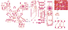 | 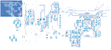 |

<b>1. main</b> · 32.0 × 52.0 mm

4-pole terminal `J1` (`12–32 V` + `RS-485 A/B`), `1.1 A` / `60 V` PTC fuse, `SMAJ36A` TVS, `SM712` RS-485 TVS, `J5` power-board cable (`VIN_PROT` out, `+5V` / `+12V_HEAT` in), `LM66100` ideal diode, socketed `Seeed XIAO ESP32-C6`, `SP3485EN` RS-485 transceiver (separate TX / RX / DE, `390 Ω` fail-safe bias, optional `120 Ω` terminator `R26`), `LSM6DS3TR-C` IMU, crown reset / boot / IRQ lines, `AO3400A` heater switch, `ADS1115` heater power monitor (`0.1 Ω` reflector + `1 Ω` probe heater shunts).

[`hardware/releases/v1/main/`](../hardware/releases/v1/main/) · [Top SVG](../hardware/releases/v1/main/renders/top.svg) · [Bottom SVG](../hardware/releases/v1/main/renders/bottom.svg) · [circuit source (SKiDL)](../hardware/circuits/variants/v1/main.py)

<b>2. crown</b> · 60 × 60 mm (transducer notches, NE cable chamfer)

`STM32G431RBT6` I²C peripheral (`0x2A`, firmware in `crown/`, reflashed by the ESP32 through the ROM I²C bootloader; SWD debug port `J12` (Tag-Connect TC2030-NL footprint, optional: a blank crown is flashed by the station)), 4× `UCC27524` H-bridge drivers + `BAV99` T/R isolation, transducer headers `J2..J5` (1 = A, 2 = B), AC-coupled receive → `74HC4052` → `TLV9062` → STM32 PGA / ADC, 4× Murata piezo headers (`J6..J9`) + charge amplifier, `AS3935` + `MA5532-AE` lightning antenna (SPI), `MMC5603NJ` compass, `XC6206` 3.3 V LDO, center 4-pin B2B socket `J10` (`to dome`).

[`hardware/releases/v1/crown/`](../hardware/releases/v1/crown/) · [Top SVG](../hardware/releases/v1/crown/renders/top.svg) · [Bottom SVG](../hardware/releases/v1/crown/renders/bottom.svg) · [circuit source (SKiDL)](../hardware/circuits/variants/v1/crown.py)

<b>3. reflector</b> · 24.0 × 24.0 mm

Horizontal de-icing heater board under the wind-tunnel cone: 4× `120 Ω` `2512` `2 W` resistors wired in parallel on `+12V_HEAT` (`30 Ω`, `4.5 W` regulated), center `10k 1%` NTC thermistor (`TH1`), and underside 4-pin SMD male header `J1` plugging directly into `probe J2`.

[`hardware/releases/v1/reflector/`](../hardware/releases/v1/reflector/) · [Top SVG](../hardware/releases/v1/reflector/renders/top.svg) · [Bottom SVG](../hardware/releases/v1/reflector/renders/bottom.svg) · [circuit source (SKiDL)](../hardware/circuits/variants/v1/reflector.py)

<b>4. dome</b> · Ø 15.6 mm round (backup: dome_legacy, Ø 13.6 mm)

Elevated UV, visible & NIR micro-PCB under the flanged PTFE dome diffuser (lathe or CNC version; backup: the `Ø 20 × 2 mm` `JGS1` window) in the crown lid: `GUVB-C21SD` (`D1`, UV-B), `TSL25911FN` (`U2`) and `GUVA-C22SD` (`D2`, UV-A) in a row on `F.Cu`, with the `TLV9062` transimpedance stage, `ADS1115` (0x49) and resistors (all below the 1.0 mm sensor tops); every ceramic capacitor and the 4-pin B2B header `J1` on `B.Cu`. The backup `dome_legacy` (Ø 13.6 mm, `LTR-390UV-01` + `TSL25911FN` + `GUVB-C31SM`) uses the same riser.

[`hardware/releases/v1/dome/`](../hardware/releases/v1/dome/) · [Top SVG](../hardware/releases/v1/dome/renders/top.svg) · [Bottom SVG](../hardware/releases/v1/dome/renders/bottom.svg) · [circuit source (SKiDL)](../hardware/circuits/variants/v1/dome.py)

<b>5. probe</b> · 14.0 × 56.0 mm

Vertical pagoda stem, bottom to top: `SHT40-AD1F-R2` (`Temp/RH`) between two milled thermal slots, `SGP41-D-R4` ($\text{VOC}/\text{NO}_x$) + `BMP585` barometer, `SCD41-D-R2` ($\text{CO}_2$) with the backside `0.42 W` parallel heater (`2× 680 Ω 1206` on `+12V_HEAT`) + `LM2903`/`TH1` `−7.6 °C` thermostat; no ground plane in the heater-side slot bridges; and top right-angle 4-pin SMD socket `J2` (`to reflector`).

[`hardware/releases/v1/probe/`](../hardware/releases/v1/probe/) · [Top SVG](../hardware/releases/v1/probe/renders/top.svg) · [Bottom SVG](../hardware/releases/v1/probe/renders/bottom.svg) · [circuit source (SKiDL)](../hardware/circuits/variants/v1/probe.py)

<b>6. power</b> · 28.5 × 21.5 mm

Two-rail supply lying flat under `main`: 2× `TPS54360` `4.5–60 V` at `743 kHz` (power stages on top, small-signal parts on the bottom): `U1` → `+5V` electronics (XIAO, sensors, PMSA003I, crown; `8.2 µH`, 2× `47 µF`) and `U2` → `+12V_HEAT` (`22 µH`, 2× `22 µF 25 V`; regulated above ≈ 13.5 V input, input − ≈ 1 V below) for the heaters, the crown transducer drivers and spare crown `J11`, so heater PWM steps and heater/cable faults never touch the electronics rail; `U3` `AP2112K-3.3` LDO → `+3V3_PROBE`, a dedicated rail for the probe sensors (SCD41 measurement peaks no longer load the XIAO regulator). 10-pin JST-SH `J1` along the top edge (half of it past `main`'s edge; plug it before fitting `main`), cabled to `main J5`; switch nodes, VIN and outputs are top-layer copper pours.

[`hardware/releases/v1/power/`](../hardware/releases/v1/power/) · [Top SVG](../hardware/releases/v1/power/renders/top.svg) · [circuit source (SKiDL)](../hardware/circuits/variants/v1/power.py)

